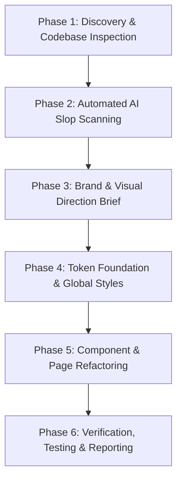

# AI Slop Remover — Website Design Intelligence & Transformation

`ai-slop-remover` is an operational frontend engineering and design direction skill. It systematically detects, diagnoses, and eliminates generic AI-generated visual patterns ("AI slop", "vibe-coded aesthetics", default template leaks) and replaces them with bespoke, intentional, human-crafted digital experiences.

When operating on an accessible codebase, this skill **does not stop at advice or critique**. It conducts code audits, establishes a unique design direction, updates styling tokens, directly refactors markup and components, and validates functionality, responsiveness, and accessibility.

---

## 1. Quick Activation Modes

The skill automatically adapts to user intent and explicit slash/chat requests:

| Mode | User Intent / Trigger | Action Taken |
|---|---|---|
| **Mode 1: Full Website Transformation** | *"Remove all AI slop from my website"* / *"Make this look like a human built it"* | End-to-end: Full audit $\rightarrow$ Design system brief $\rightarrow$ Token & foundation update $\rightarrow$ Structural refactor $\rightarrow$ Page-by-page transformation $\rightarrow$ Automated test validation. |
| **Mode 2: AI Slop Audit Only** | *"Audit my site for AI slop, don't edit anything"* / *"Critique my UI"* | Read-only inspection using scanner scripts $\rightarrow$ Detailed audit report with 100-point score, severity ranking, and exact code locations. |
| **Mode 3: Specific Component Redesign** | *"Redesign my hero section"* / *"Fix these feature cards"* | Inspect target component $\rightarrow$ Identify AI tells $\rightarrow$ Select from bespoke archetypes $\rightarrow$ Direct in-place refactor $\rightarrow$ Verify responsive behavior. |
| **Mode 4: Complete Visual Redesign** | *"Rebrand this into a high-end luxury/editorial site"* | Rebuild typography, color theory, layout spacing, and art direction while keeping application logic 100% intact. |
| **Mode 5: Typography Transformation** | *"Fix our generic fonts"* / *"Stop using Inter everywhere"* | Audit type scale, eliminate generic fonts, implement brand-aligned display/body/mono pairings with full language support (including Hindi/Devanagari if relevant). |
| **Mode 6: Mobile Experience Redesign** | *"Desktop looks fine but mobile feels crammed and broken"* | Eliminate squished desktop layouts; build intentional mobile ergonomics (touch targets $\ge 48\text{px}$, drawer navigation, responsive tables). |
| **Mode 7: Design Consistency Pass** | *"Make our colors, buttons, and spacing consistent"* | Extract ad-hoc classes and scattered Tailwind colors into a unified token system, eliminating redundant duplicate styles. |
| **Mode 8: Incremental Redesign** | *"Improve just my homepage first"* | Scope changes to the landing page and its direct dependencies without mutating unrelated application views. |

---

## 2. Core Execution Workflow

Every transformation follows a strict 6-phase engineering pipeline:

### Phase 1: Codebase & Architecture Inspection
Before altering a single CSS property, run the discovery workflow:
1. **Identify the Stack**: Inspect `package.json`, build configs, routing structure, and style mechanisms (Tailwind v3/v4, CSS Modules, Styled Components, vanilla CSS, Bootstrap, or server-rendered templates).
2. **Determine Purpose & Domain**: Classify the site against the [Industry Design Guide](file:///references/industry-design-guide.md) (e.g., SaaS, Government, Exam Portal, Healthcare, E-Commerce). Never apply a trendy SaaS aesthetic to a government portal or educational utility.
3. **Establish Baseline Screenshots/Snapshots**: When browser tools (Playwright, Chrome DevTools) are available, capture pre-redesign visual baselines at 390px (mobile) and 1440px (desktop).

### Phase 2: AI Slop Detection & Pattern Diagnosis
Execute the automated python scanners or perform structured AST/regex grep inspections:
- Run `python scripts/design-pattern-scanner.py <src-dir>` to locate purple/indigo gradients, Inter monotony, oversized border-radii, glassmorphic card spam, and generic buzzwords.
- Run `python scripts/duplicate-style-detector.py <src-dir>` to identify conflicting inline styles and ad-hoc utility sprawl.
- Check against the 22 core slop patterns documented in the [AI Slop Pattern Library](file:///references/ai-slop-pattern-library.md).
- Calculate the initial score using the 100-point [Website Quality Checklist](file:///references/website-quality-checklist.md).

### Phase 3: Visual Direction & Design Brief
Formulate an intentional, non-generic design direction. Record in your working notes or client report:
1. **Brand Personality**: (e.g., *Tactile Architectural Editorial*, *High-Density Academic Precision*, *Warm Humanist Utility*).
2. **Typography System**: One distinct display/heading typeface + one highly legible body typeface + optional code/data mono. See [Typography & Font Selection](file:///references/typography-and-font-selection.md).
3. **Color Architecture**: Eliminate the default `#6366f1` / `#9333ea` palette. Establish grounded surface tokens, crisp high-contrast text, intentional accent pops, and calibrated dark/light contrasts. See [Color & Visual Identity](file:///references/color-and-visual-identity.md).
4. **Layout Philosophy**: Asymmetric columns, intentional whitespace, crisp 1px borders, subtle print-inspired dividers. See [Layout & Spacing System](file:///references/layout-and-spacing-system.md).

### Phase 4: Token Foundation & Global Styles
Implement the design system at the root level first:
- Update CSS variables (`:root`, `.dark`) or Tailwind configuration (`tailwind.config.js` or Tailwind v4 `@theme` block in CSS).
- Replace generic font links with optimized, variable web fonts with fallback metrics to eliminate layout shifts (CLS).
- Define global base typography, standard button interaction states, and focus rings.

### Phase 5: Component & Page-by-Page Refactor
Refactor in hierarchical order to avoid visual dissonance:
1. **Header & Navigation**: Eliminate oversized floating glass pills; build solid, information-dense, accessible navigation ([Navigation & Header Design](file:///references/navigation-and-header-design.md)).
2. **Hero Section**: Strip generic centered badges and buzzword headlines; implement a domain-specific hero archetype ([Hero Section Design](file:///references/hero-section-design.md)).
3. **Feature Presentations**: Break up identical 3-card bento grids using varied layouts, data-led callouts, interactive demos, or editorial lists ([Component Redesign Guide](file:///references/component-redesign-guide.md)).
4. **Copywriting Polish**: Rewrite empty filler copy ("Empower your workflow") into specific, factual, benefit-driven messaging.
5. **Secondary Pages & Utilities**: Ensure internal routes, forms, tables, modals, error states, and footers share the same refined design language.

### Phase 6: Verification, Accessibility & Build Guardrails
Never leave the codebase in an unverified state:
1. **Functional Integrity**: Verify that routing, form handlers, state hooks, and API endpoints remain unchanged.
2. **Responsive Verification**: Test at 320px, 390px, 768px, 1024px, and 1440px ([Responsive Design Guide](file:///references/responsive-design-guide.md)).
3. **Accessibility**: Validate WCAG 2.2 AA compliance: minimum 4.5:1 text contrast, visible `:focus-visible` outlines, semantic headings, and ARIA labels ([Accessibility Standards](file:///references/accessibility-standards.md)).
4. **Build & Test**: Execute project build commands (`npm run build`, `vite build`, `tsc --noEmit`) and existing test suites (`vitest`, `jest`, `playwright`).
5. **Final Audit Report**: Deliver the completed report using [design-audit-report-template.md](file:///assets/design-audit-report-template.md).

---

## 3. Strict Operating Rules

1. **Inspect First, Never Guess**: Always examine actual files and styles before writing replacement code. Never assume Tailwind or React is present.
2. **Preserve Application Logic**: Redesign visual presentation without altering underlying React state hooks, Angular bindings, Vue computed properties, form submission payloads, or API contracts.
3. **Zero Hallucinated Proof**: Never fabricate user testimonials, company logos, trust badges, or fake statistical achievements to pad an empty layout.
4. **Purpose Over Novelty**: Do not replace AI slop with trendy chaos. A government portal needs clarity, high information density, and trust; a developer tool needs keyboard accessibility and monospace data clarity.
5. **No Blind Dependency Bloat**: Never add heavy 3D WebGL libraries, bloated UI packages, or unvetted scripts to solve a problem that clean CSS and semantic HTML can resolve.
6. **No Placeholder Code**: Never leave `/* Add styles here */` or `// implement later`. Every file edit must be complete, functional, and production-ready.

---

## 4. Reference Index

Specialist reference guides are available in `references/`:
- **Patterns & Anti-Patterns**: [AI Slop Pattern Library](file:///references/ai-slop-pattern-library.md)
- **Design Philosophy**: [Premium Website Design Principles](file:///references/premium-website-design-principles.md)
- **Typography & Font Rules**: [Typography & Font Selection](file:///references/typography-and-font-selection.md)
- **Color Systems & Tokens**: [Color & Visual Identity](file:///references/color-and-visual-identity.md)
- **Hero Transformations**: [Hero Section Design](file:///references/hero-section-design.md)
- **Navigation Systems**: [Navigation & Header Design](file:///references/navigation-and-header-design.md)
- **Layout & Spacing**: [Layout & Spacing System](file:///references/layout-and-spacing-system.md)
- **Component Catalogue**: [Component Redesign Guide](file:///references/component-redesign-guide.md)
- **Sector-Specific Rules**: [Industry Design Guide](file:///references/industry-design-guide.md)
- **Responsive Systems**: [Responsive Design Guide](file:///references/responsive-design-guide.md)
- **Accessibility & WCAG**: [Accessibility Standards](file:///references/accessibility-standards.md)
- **Motion & Micro-Interactions**: [Animation & Interaction Guide](file:///references/animation-and-interaction-guide.md)
- **Media & Assets**: [Image & Asset Selection](file:///references/image-and-asset-selection.md)
- **Scoring & Checklist**: [Website Quality Checklist](file:///references/website-quality-checklist.md)
- **Concrete Code Examples**: [Before-and-After Transformations](file:///references/before-after-examples.md)
- **Test Benchmark Scenarios**: [Testing & Evaluation Scenarios](file:///references/testing-and-evaluation-scenarios.md)
- **Research Bibliography**: [Research & Citations](file:///references/research-and-citations.md)

---

## 5. Tooling & Automation Scripts

Audit scripts are provided in `scripts/`:
- `scripts/website-audit.py`: Full project discovery, route inventory, asset catalogue, and technology stack fingerprinting.
- `scripts/design-pattern-scanner.py`: AST and regex scanning tool flagging 18+ specific AI slop design tokens and calculating slop density.
- `scripts/duplicate-style-detector.py`: Scans stylesheets and component files for conflicting utility classes and duplicated styles.
- `scripts/asset-audit.py`: Audits images, icons, and fonts for layout shifts, missing alt attributes, and heavy payload weights.
- `scripts/validation-checker.py`: Validates build status, TypeScript compliance, WCAG contrast ratios, and responsive viewport integrity.

